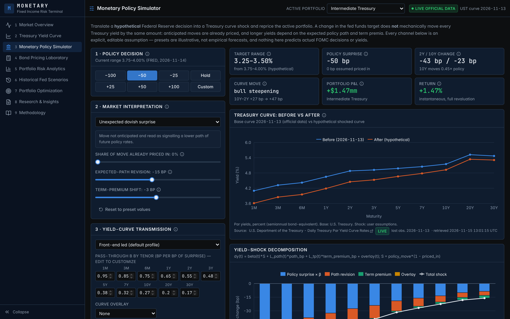
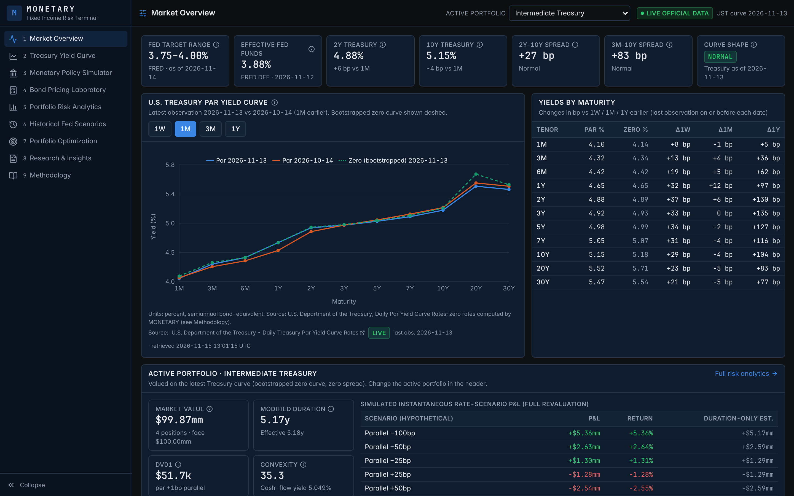
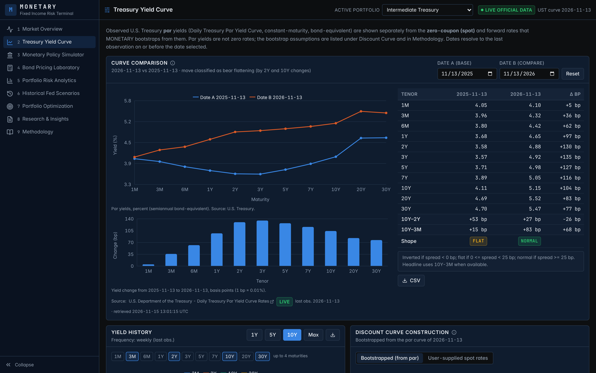
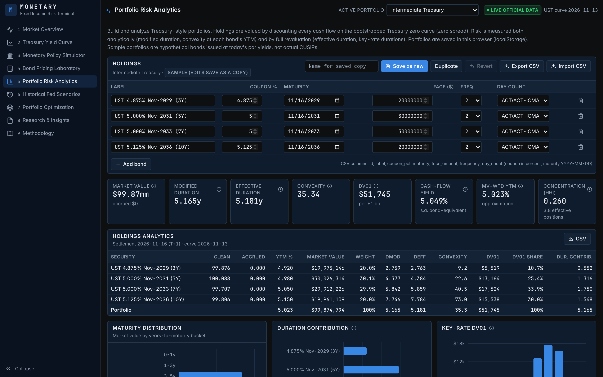
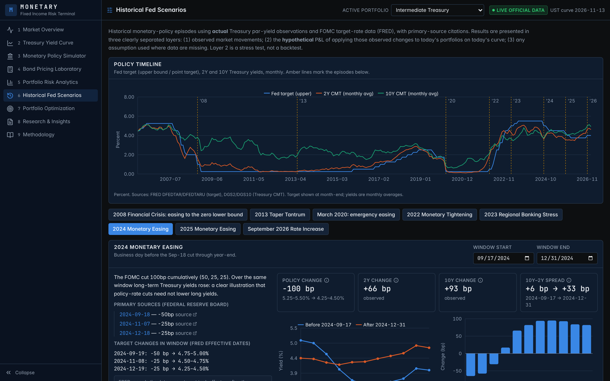
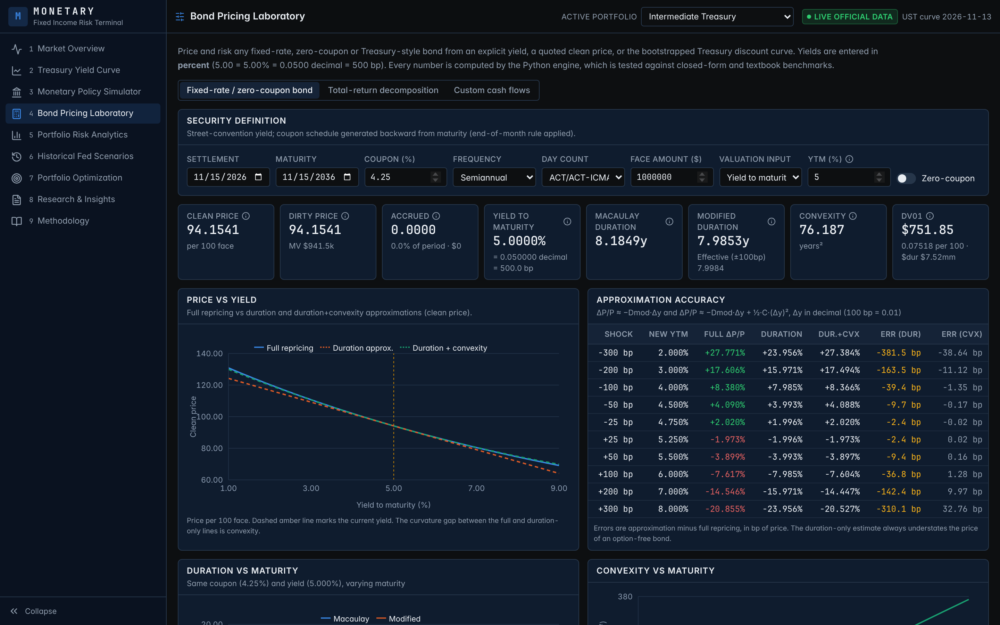
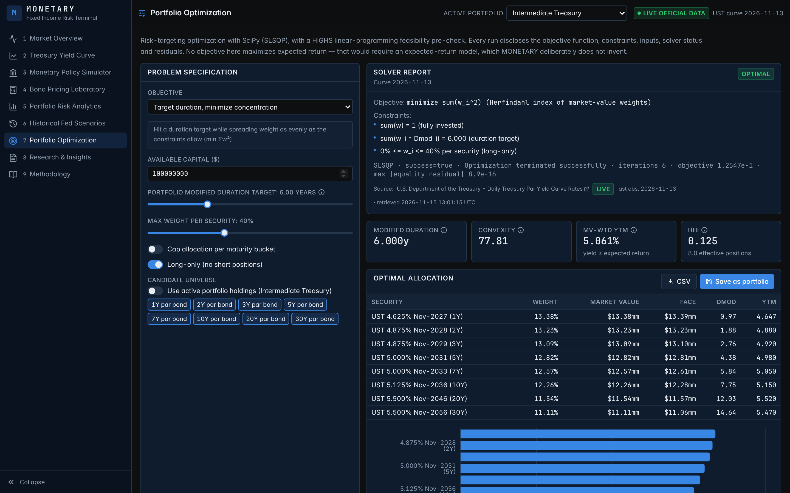
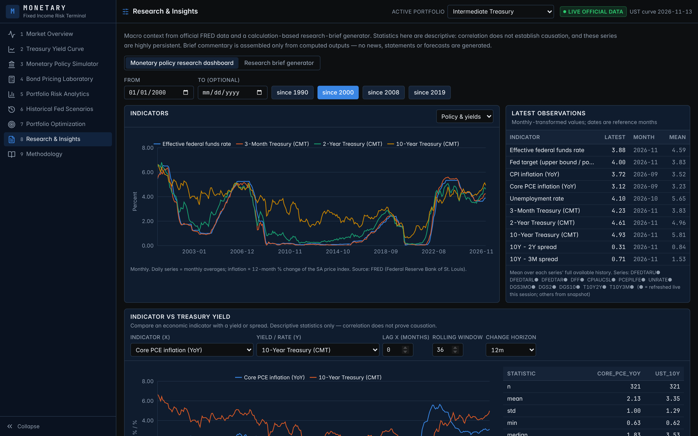

# MONETARY — Fixed Income & Monetary Policy Risk Terminal

**An interactive quantitative research platform exploring the relationship between monetary policy, Treasury yield curves, and fixed-income portfolio risk.**

**Live site:** deployed on Vercel — the full Python analytics engine runs in your browser (first visit downloads ~40 MB and takes ~15 s; cached afterwards).

MONETARY is a full-stack fixed-income analytics application: a tested Python pricing and risk engine (NumPy / SciPy / pandas, served through FastAPI) behind a Next.js research terminal. It ingests official U.S. Treasury and Federal Reserve data, bootstraps a discount curve from Treasury par yields, prices and risk-manages bond portfolios with full cash-flow revaluation, translates hypothetical Federal Reserve decisions into yield-curve shocks through explicit, editable assumptions, replays historical policy episodes, and solves constrained portfolio-construction problems.

> **What it is not:** a forecasting model. Scenario tools translate *user-specified* assumptions into analytics; they do not predict FOMC decisions or Treasury yields. Historical replays are stress tests, not backtests. Every assumption is shown next to the result it produces.



---

## Contents
- [Overview](#overview) · [Key features](#key-features) · [Screenshots](#screenshots) · [Architecture](#architecture)
- [Financial models](#financial-models) · [Formulas](#formulas) · [Data sources](#data-sources)
- [Installation](#installation) · [Running locally](#running-locally) · [Testing](#testing) · [Deployment](#deployment)
- [Limitations](#limitations) · [Future research extensions](#future-research-extensions)
- [Why this project matters for fixed income research](#why-this-project-matters-for-fixed-income-research)
- [Sample research scenarios](#sample-research-scenarios-reproducible-in-the-app) · [Resume bullet & launch post](#resume-bullet)

---

## Overview

| Layer | What it does |
|---|---|
| **Data** | Downloads the U.S. Treasury Daily Par Yield Curve (1990–present) and 12 FRED series; caches with source-specific refresh intervals; falls back to a bundled snapshot of the same official data, always labeled *not live*. Missing data are never filled; date lookups never look ahead. |
| **Quant engine** | Day counts (ACT/ACT-ICMA, 30/360, ACT/360, ACT/365F), coupon schedules, clean/dirty pricing, Brent-method YTM, Macaulay/modified/effective duration, convexity, DV01, horizon-return decomposition, par→zero bootstrapping, key-rate durations, scenario repricing, portfolio aggregation, SLSQP optimization. |
| **API** | 33 FastAPI endpoints with Pydantic validation, explicit units in every field name (`_pct`, `_bp`), provenance on every market-data response, PDF report rendering. |
| **Terminal UI** | Next.js 15 + TypeScript + Tailwind + shadcn/ui-style Radix components + Recharts. Nine sections, every control wired to the engine, tooltips on every metric, units and sources on every chart. |

## Key features

1. **Market Overview** — Fed target range and effective fed funds (FRED), Treasury par and bootstrapped zero yields by maturity, 2Y–10Y and 3M–10Y spreads with a transparent shape classification, curve vs 1W/1M/3M/1Y ago, and the active portfolio's market value, duration, DV01, convexity and a 10-scenario stress grid.
2. **Treasury Yield Curve** — any two historical dates compared (bp changes, spreads, shape), multi-maturity history with the 10Y–2Y spread, discount-curve construction (par vs zero vs 6M forward), an alternative curve from **user-supplied spot rates**, and a shock lab: parallel, bull/bear steepeners & flatteners, twists, butterflies, or custom maturity-by-maturity shocks — with save/load.
3. **Monetary Policy Simulator (flagship)** — choose a cut/hold/hike (or custom), a market interpretation (expected, hawkish/dovish surprise, inflation shock, recession shock, higher-for-longer), and a transmission profile (front-end led, parallel benchmark, steepening, flattening, credibility twist, or custom pass-through by tenor) plus an optional curve overlay. The page shows the yield-shock decomposition by channel, before/after curves, before/after portfolio value, duration, convexity, DV01 and key-rate exposures, security-level repricing, a P&L waterfall, first-order key-rate P&L attribution, and a plain-English interpretation generated from the computed numbers. Exports a one-page PDF brief.
4. **Bond Pricing Laboratory** — fixed-rate, zero-coupon and Treasury-style bonds valued from a yield, a clean price, or the Treasury curve; cash-flow table with discount factors; price–yield chart with duration and convexity approximations; approximation-error table; duration and convexity vs maturity; horizon total-return decomposition; arbitrary custom cash flows with any compounding.
5. **Portfolio Risk Analytics** — editable holdings (add/remove/resize/change maturity & coupon), save/load/rename/duplicate in the browser, CSV import (validated) and export, six sample portfolios (short, intermediate, long, bullet, duration-matched barbell, ladder), holdings analytics, maturity distribution, duration contribution, key-rate DV01, concentration (HHI, DV01 share) warnings, scenario P&L attribution (full revaluation vs KRD vs KRD+convexity), and side-by-side portfolio comparison.
6. **Historical Fed Scenarios** — eight cited episodes (2008 crisis, 2013 taper tantrum, March 2020, 2022 tightening, 2023 banking stress, 2024 and 2025 easing, September 2026 increase) on a policy timeline; observed curve moves with announcement dates linked to federalreserve.gov; target changes from FRED; observed changes applied to today's portfolios and compared across portfolios — clearly separated into *observed*, *hypothetical*, and *assumption* layers. Windows are adjustable.
7. **Portfolio Optimization** — target duration with minimum concentration, benchmark key-rate matching, weighted deviation from a KRD target, and (explicitly labeled) yield maximization; position, bucket and long-only constraints; available capital; LP feasibility pre-check; solver report with objective, constraints, status, iterations and residuals; duration-matched barbell vs bullet with scenario grid.
8. **Research & Insights** — FRED dashboard (fed funds, CPI and core PCE inflation, unemployment, 2Y/10Y, spreads), indicator-vs-yield comparison with lag, level and change correlations, rolling correlations, descriptive statistics, a correlation matrix, a conceptual transmission diagram; and a research-brief generator with PDF export.
9. **Methodology** — every formula, convention, data rule, assumption, test and limitation, with references.

## Screenshots

| | |
|---|---|
|  **Market Overview** |  **Treasury Yield Curve** |
|  **Portfolio Risk Analytics** |  **Historical Fed Scenarios** |
|  **Bond Pricing Laboratory** |  **Portfolio Optimization** |
|  **Research & Insights** |  **Monetary Policy Simulator** |

## Architecture

```
monetary/
├── backend/                       Python 3.13 · FastAPI
│   ├── app/
│   │   ├── config.py              env-driven settings (data mode, TTLs, timeouts, CORS)
│   │   ├── data/
│   │   │   ├── sources.py         Treasury & FRED ingestion + validation (no filling)
│   │   │   ├── store.py           cache, refresh policy, live→snapshot fallback, provenance, no-look-ahead lookup
│   │   │   └── events.py          curated historical episodes with primary-source links
│   │   ├── core/                  pure, deterministic quant engine (no I/O)
│   │   │   ├── daycount.py        ACT/ACT-ICMA, 30/360 US, ACT/360, ACT/365F
│   │   │   ├── schedule.py        backward coupon schedules, EOM rule, T+1 settlement
│   │   │   ├── bond.py            cash flows, price/yield (Brent), duration, convexity, DV01, horizon return
│   │   │   ├── curve.py           par curve, bootstrapping, zero/forward rates, spot-rate curves, shape
│   │   │   ├── risk.py            curve repricing, effective duration/convexity, key-rate durations
│   │   │   ├── scenarios.py       parallel / slope / twist / butterfly / custom shock generators
│   │   │   ├── policy.py          monetary-policy → curve-shock translation (explicit channels)
│   │   │   ├── portfolio.py       aggregation, buckets, concentration, scenario P&L attribution, samples
│   │   │   ├── historical.py      observed vs hypothetical episode analysis
│   │   │   ├── optimization.py    SLSQP + HiGHS feasibility, barbell vs bullet
│   │   │   ├── macro.py           monthly alignment, correlations, rolling stats
│   │   │   ├── narrative.py       template commentary from computed outputs only
│   │   │   └── report.py          research brief + ReportLab PDF
│   │   ├── api/                   Pydantic schemas, routes, shared helpers
│   │   ├── browser.py             in-browser dispatcher: same routes, run in Pyodide (static site)
│   │   └── main.py                FastAPI app, error mapping, CORS, gzip
│   ├── data/snapshot/             bundled official data (Treasury 1990–2026, FRED) + metadata.json
│   ├── scripts/build_snapshot.py  re-downloads the snapshot from official sources
│   └── tests/                     114 pytest tests
├── frontend/                      Next.js 15 · TypeScript · Tailwind · Radix (shadcn/ui pattern) · Recharts
│   ├── app/                       one route per section (9) + layout
│   ├── components/                shell, charts, shock editor, ui primitives
│   ├── lib/                       typed API client & hooks, in-browser engine bridge, portfolio store, CSV, glossary
│   ├── public/engine/worker.js    Web Worker that boots Pyodide and the Python engine
│   └── scripts/bundle-engine.mjs  packs backend/app + data snapshot for the static build
├── render.yaml                    Render blueprint (backend)
├── .github/workflows/ci.yml       pytest + typecheck + production build
├── .github/workflows/data-refresh.yml  weekday official-data refresh → tests → commit (triggers redeploy)
├── vercel.json                    static-site build for Vercel (in-browser engine)
└── docs/screenshots/
```

**Two deployment modes, one engine.**
- *Server mode:* the browser calls relative `/api/*`; Next.js rewrites to the FastAPI backend (`BACKEND_URL`), so there is one configuration point and no CORS in normal use.
- *Static mode (the live site):* `NEXT_PUBLIC_ENGINE=browser` produces a static export. The same Python package runs in a Web Worker under [Pyodide](https://pyodide.org) (CPython compiled to WebAssembly, with NumPy, pandas, SciPy, Pydantic and FastAPI). `app/browser.py` matches each request against the FastAPI router, validates parameters with Pydantic and calls the route function directly; a parity test asserts its responses equal the server's for every endpoint type. Browsers cannot download Treasury/FRED data directly (no CORS), so the static site serves the bundled snapshot; a scheduled workflow re-downloads the official data every weekday, tests the engine on it and commits it, which redeploys the site. The data are always labeled with their retrieval time. The engine is stateless and deterministic: given a curve date and positions, every number is reproducible. Portfolios and saved scenarios live in the user's browser.

## Financial models

- **Valuation:** Treasury-style bonds discounted cash flow by cash flow on a zero curve bootstrapped from Treasury par yields (zero spread). YTM is then solved from that model price. Yield-based pricing (street convention) is available in the Bond Lab.
- **Curve:** linear par interpolation; bills as bond-equivalent zeros; semiannual par-bond bootstrap to 30Y; log-linear discount factors (piecewise-flat forwards). User spot curves supported as an alternative.
- **Risk:** analytic Macaulay/modified duration and convexity at each bond's YTM; effective duration/convexity and key-rate durations by ±1 bp par-curve bumps with full re-bootstrapping (Ho, 1992).
- **Scenarios:** instantaneous shocks to par yields, full revaluation, with first-order (KRD) and second-order (KRD + convexity) approximations alongside for comparison.
- **Policy transmission:** `Δy(t) = β(t)·S + L_path(t)·path + L_tp(t)·term_premium + overlay(t)`, with `S = move × (1 − priced_in)`. A fully anticipated move produces no surprise shock — the core reason a fed funds change is not mechanically passed through to Treasury yields.
- **Optimization:** quadratic risk-shape objectives under linear constraints (SLSQP), with an LP feasibility check (HiGHS). No expected-return model is assumed.

## Formulas

```
Dirty price (street):  P = Σ CFₖ / (1 + y/f)^(w + k − 1)            Clean = Dirty − Accrued
Accrued (ACT/ACT):     AI = (C/f) · days(prev → settle) / days(prev → next)
Macaulay duration:     D_mac = Σ tₖ PVₖ / P          Modified: D_mod = D_mac / (1 + y/f)
Convexity:             C = Σ PVₖ tₖ (tₖ + 1/f) / [P (1 + y/f)²]
DV01:                  D_mod × P × 0.0001          (positive = loss for +1 bp)
Approximations:        ΔP/P ≈ −D_mod Δy            ΔP/P ≈ −D_mod Δy + ½ C (Δy)²
Effective duration:    (P₋ − P₊) / (2 P₀ Δy)       Key-rate duration: same, bumping one tenor
Bootstrap (t > 1y):    DF(t) = (1 − c/2 · Σ_{tⱼ<t} DF(tⱼ)) / (1 + c/2)
Zero rate (s.a.):      z(t) = 2 (DF(t)^(−1/(2t)) − 1)
Horizon return:        coupons + reinvestment + ΔAI + [Clean(h,y₀) − Clean(0,y₀)] + [Clean(h,y₁) − Clean(h,y₀)]
Cash-flow yield:       y such that Σ portfolio CFs discounted at y = total dirty MV
```
Full derivations, conventions and edge cases are on the in-app **Methodology** page.

## Data sources

| Source | Series | Use |
|---|---|---|
| U.S. Department of the Treasury — [Daily Treasury Par Yield Curve Rates](https://home.treasury.gov/resource-center/data-chart-center/interest-rates/TextView?type=daily_treasury_yield_curve) | 1M, 3M, 6M, 1Y, 2Y, 3Y, 5Y, 7Y, 10Y, 20Y, 30Y (1990–present) | curve, bootstrapping, valuation, history |
| [FRED](https://fred.stlouisfed.org), Federal Reserve Bank of St. Louis | DFEDTARU, DFEDTARL, DFEDTAR, DFF, CPIAUCSL, PCEPILFE, UNRATE, DGS3MO, DGS2, DGS10, T10Y2Y, T10Y3M | policy rate, macro dashboard, timeline |
| [Board of Governors of the Federal Reserve System](https://www.federalreserve.gov/newsevents/pressreleases.htm) | FOMC statements, press releases, testimony | historical event citations |

**Integrity rules:** values outside [−5%, 30%] are rejected at ingestion; unpublished tenors are excluded (and flagged) rather than filled; every lookup uses the last observation on or before the requested date; every response carries provenance (`live`, `snapshot`, or `user`). Data mode is controlled by `MONETARY_DATA_MODE` = `auto` (default: official sources, snapshot fallback) | `live` | `snapshot` (offline demo). The bundled snapshot was retrieved on 2026-11-15 and runs through 2026-11-13; refresh it with `make snapshot`.

## Installation

Requirements: Python 3.11+ (developed on 3.13), Node.js 20+ (developed on 22).

```bash
git clone <your-repo-url> monetary && cd monetary
```
```bash
make install
```
or manually:
```bash
cd backend && python3 -m venv .venv && . .venv/bin/activate && pip install -r requirements-dev.txt
```
```bash
cd frontend && npm ci
```

## Running locally

Terminal 1 — API on http://127.0.0.1:8000 (interactive docs at `/docs`):
```bash
cd backend && . .venv/bin/activate && uvicorn app.main:app --reload --port 8000
```
Terminal 2 — terminal UI on http://localhost:3000:
```bash
cd frontend && npm run dev
```
Offline demo mode (bundled official data only, labeled as snapshot):
```bash
cd backend && MONETARY_DATA_MODE=snapshot uvicorn app.main:app --port 8000
```
Optional environment variables are documented in `backend/.env.example` and `frontend/.env.example` (a FRED API key is optional; the keyless CSV endpoint is used otherwise).

## Testing

```bash
cd backend && . .venv/bin/activate && MONETARY_DATA_MODE=snapshot python -m pytest -q
```
```bash
cd frontend && npm run typecheck && npm run build
```

114 backend tests cover: zero-coupon and coupon prices against closed forms and textbook values (Fabozzi 134.6722 and 91.9770; Hull Table 4.6 94.213 / 2.653), 50 randomized bonds against closed-form price and Macaulay duration, YTM round trips, duration and convexity vs finite differences, DV01 sign and magnitude, ACT/ACT and 30/360 accrued interest by hand, EOM schedules, par-bond repricing through the bootstrap, KRDs summing to effective duration, portfolio aggregation and scaling identities, parallel and non-parallel shocks (including locality), convexity improving approximations, policy-channel decomposition, optimizer constraints/residuals/infeasibility, missing-data handling, no-look-ahead date alignment, every cited rate-change announcement aligning with a FRED target change, API validation, single-page PDF output, and response parity between the in-browser dispatcher and the FastAPI server. CI runs the suite plus a frontend typecheck and production build.

## Deployment

**Backend → Render** (free tier works; the snapshot is bundled so cold starts never depend on external APIs):
1. Push this repository to GitHub.
2. Render → *New* → *Blueprint* → select the repo. `render.yaml` creates `monetary-api` (root `backend/`, build `pip install -r requirements.txt`, start `uvicorn app.main:app --host 0.0.0.0 --port $PORT`, health check `/api/health`).
3. Optionally set `FRED_API_KEY`. Note the service URL, e.g. `https://monetary-api.onrender.com`.

A `backend/Dockerfile` is included for Fly.io, Railway, Cloud Run, etc.

**Static website → Vercel (how the live site is deployed; no backend server needed):**
1. vercel.com → sign in with GitHub → *Add New → Project* → import this repository.
2. Leave every setting as detected — the root `vercel.json` installs `frontend/`, bundles the Python engine and data, and publishes `frontend/out`. Choose the project name you want in the URL (e.g. `monetary-terminal` → `monetary-terminal.vercel.app`).
3. Deploy. Every push to `main` — including the weekday data-refresh commits from `.github/workflows/data-refresh.yml` — redeploys automatically.

Build and preview the static site locally:
```bash
cd frontend && node scripts/bundle-engine.mjs && NEXT_PUBLIC_ENGINE=browser npm run build && npx serve out
```

**Frontend → Vercel (server mode, with the Render backend):** create a second Vercel project with *Root Directory* `frontend` and *Framework* Next.js:
1. Add environment variable `BACKEND_URL=https://monetary-api.onrender.com` (used by the `/api/*` rewrite at build time).
2. Deploy. Redeploy the frontend if the backend URL changes.

Because the browser only talks to the Vercel domain (Next.js proxies `/api/*`), no CORS configuration is required; `MONETARY_CORS_ORIGINS` exists for direct API access.

## Limitations

- Securities are generic Treasury-style fixed-rate bonds at zero spread — no credit, liquidity, repo specialness, optionality (callables, MBS), TIPS or floaters. Sample portfolios are hypothetical bonds at today's par yields, not CUSIPs.
- The par curve is Treasury's on-the-run-based CMT curve; linear par interpolation is transparent but produces kinks in forward rates. It is not a fitted (e.g. Svensson) curve.
- Scenarios are instantaneous with static positions; carry and roll-down appear only in the Bond Lab horizon tool.
- Policy pass-through coefficients and interpretation presets are illustrative assumptions, informed in direction by the event-study literature but not estimated here.
- Historical replays apply observed yield changes to today's curve; they are not backtests of holdings through time.
- Settlement ignores holidays; Treasury's final-period simple-interest yield convention is not implemented.
- Macro statistics are descriptive; correlations of persistent series are not causal evidence.

## Future research extensions

- Fit a Nelson–Siegel–Svensson curve and compare KRDs and forwards with the bootstrap.
- Estimate pass-through coefficients by event study on FOMC days using fed funds futures surprises (Kuttner; Gürkaynak–Sack–Swanson), with confidence intervals.
- Decompose yields into expected short rates and term premium (ACM / Kim–Wright data from the Fed) and drive scenarios by component.
- Principal-component (level/slope/curvature) risk model and historical / Monte Carlo VaR on yield changes.
- Horizon scenario analysis with carry, roll-down and reinvestment; true backtests with historical holdings.
- Actual Treasury securities (CUSIPs, auction data) and spread products (agencies, IG corporates with spread duration).

## Why this project matters for fixed income research

- **Policy expectations, not policy rates, move most of the curve.** The simulator forces the distinction between a policy *move* and a policy *surprise*, separates the expected-path and term-premium channels, and shows why long yields can rise while the Fed cuts (as in the 2024 replay).
- **Duration is not one number.** Two portfolios with identical modified duration (bullet vs duration-matched barbell) can have opposite key-rate exposures, different convexity and yield, and very different outcomes under steepeners, flatteners and butterflies.
- **Approximations have errors you can measure.** Full revaluation is always the reference; duration and convexity estimates are shown next to it with their error, the way a risk team validates a model.
- **Data discipline.** Par yields are not zero rates; missing tenors are not filled; no look-ahead; live vs snapshot is always labeled; historical replays are not called backtests; yield maximization is not called return optimization.
- **Reproducibility.** A tested, deterministic engine with documented conventions mirrors how institutional analytics are built and audited.

## Sample research scenarios (reproducible in the app)

Numbers below were produced by the app on the Treasury curve of **2026-11-13** (snapshot retrieved 2026-11-15). With live data, values will differ as the curve moves; the steps reproduce them for any date.

**1. A 50 bp dovish surprise is not a 50 bp rally.** *Monetary Policy Simulator* → active portfolio *Intermediate Treasury* → −50 → *Unexpected dovish surprise* (0% priced in, path −15 bp, term premium −3 bp) → *Front-end led*. The assumed shock is −47 bp at 3M, −43 bp at 2Y, −31.6 bp at 5Y, −22.5 bp at 10Y and −16 bp at 30Y — a bull steepening, with the 10Y moving 0.45× the policy change. The portfolio gains **+$1.47mm (+1.47%)** on $99.9mm by full revaluation; the first-order KRD estimate is +$1.45mm and adding convexity gives +$1.46mm. Switch the interpretation to *Expected policy move* and the shock — and P&L — fall to **zero**: a fully priced cut moves nothing through the surprise channel.

**2. Same duration, different risk: barbell vs bullet.** *Portfolio Optimization* → *Barbell vs bullet* (10Y bullet; 2Y/30Y wings). The duration-matched barbell is 54.1% 2Y / 45.9% 30Y with modified duration 7.75 (equal to the bullet), convexity **151 vs 73**, and cash-flow yield 5.39% vs 5.15% (the 20–30Y sector yields more than 10Y on this date). Instantaneous returns: parallel ±100 bp favors the barbell by 35–45 bp (convexity); a bear flattener (2Y +50, 10Y +15) favors the bullet by 35 bp; a positive butterfly (wings +20, 7Y belly −20) favors the bullet by **270 bp** — key-rate exposure, not duration, drives the result.

**3. The 2024 easing cycle: rate cuts, higher long yields.** *Historical Fed Scenarios* → *2024 Monetary Easing* (window 2024-09-17 → 2024-12-31). Observed: target −100 bp (5.25–5.50% → 4.25–4.50%), 3M −58 bp, yet 2Y **+66 bp**, 10Y **+93 bp**, 30Y +82 bp; the 10Y–2Y spread went from 6 to 33 bp. Applying those observed changes to today's sample portfolios as an instantaneous shock (a stress test, not a backtest): short-duration −1.22%, ladder −4.03%, intermediate −4.67%, duration-matched barbell −5.73%, 10Y bullet −6.94%, long-duration −9.36%. For contrast, the 2023 banking-stress window shows the 2Y −129 bp while the Fed *raised* 25 bp.

## Resume bullet

> Built **MONETARY**, a full-stack fixed-income risk terminal (Python/FastAPI, NumPy/SciPy/pandas, Next.js/TypeScript) that ingests U.S. Treasury and FRED data, bootstraps a zero curve from par yields, prices and risk-manages bond portfolios (duration, convexity, DV01, key-rate durations, full-revaluation scenario P&L), translates hypothetical Fed decisions into curve shocks via explicit pass-through assumptions, replays eight cited policy episodes, and runs constrained SLSQP portfolio optimization; validated with 114 unit tests against closed-form and textbook benchmarks; deployed as a static site with the Python engine running client-side via Pyodide/WebAssembly.

A LinkedIn launch post is in [`docs/LINKEDIN_POST.md`](docs/LINKEDIN_POST.md).

## References

Fabozzi, *Bond Markets, Analysis, and Strategies* · Tuckman & Serrat, *Fixed Income Securities* · Hull, *Options, Futures, and Other Derivatives* · Ho (1992), *Journal of Fixed Income* · Kuttner (2001), *JME* · Gürkaynak, Sack & Swanson (2005), *IJCB* · Gürkaynak, Sack & Wright (2007), *JME* · Estrella & Mishkin (1996), FRBNY *Current Issues* · Granger & Newbold (1974), *J. Econometrics*.

*Research and education tool. Not investment advice.*
